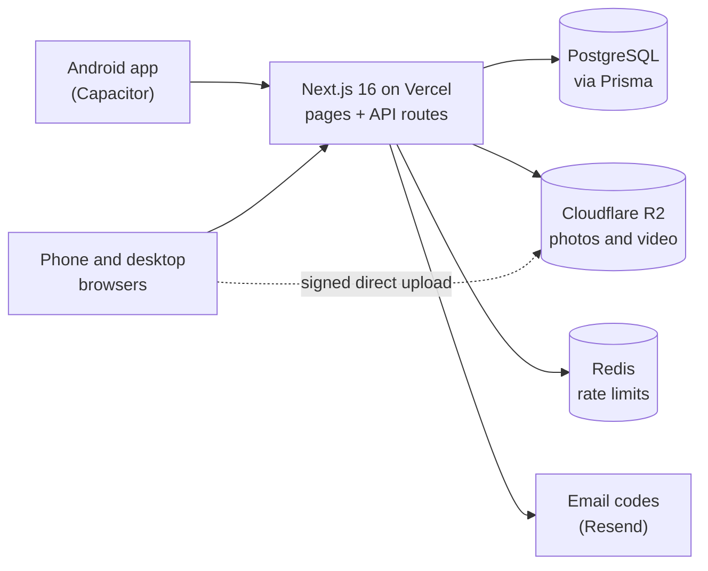

# YORNA — a mobile-first social marketplace for Cambodia

Shopping, short video, chat and seller tools in one app, in Khmer and English.
A Next.js web app that also ships as an Android app.

This repository is a **case study with real code from the project**. The app itself
is private while it is in development, so what is here is chosen to be read and run:
two modules with their tests, and the developer tools the project uses every day.

## How it fits together



One codebase serves the phone, the desktop and the Android app. Photos and videos go
straight from the phone to storage with a signed link; the server checks them afterwards.

## The product

- **Five tabs you can swipe between** — Video, Home (a feed with stories and rooms), Market, Chat, Profile.
- **Market** — catalogue, product pages, local shops, cart and cash-on-delivery checkout. Sellers get a dashboard.
- **Chat** — one-to-one and group chats, with deals made inside a conversation.
- **Coins** — buy coins, send gifts, and **Boost a post**: anybody pays coins to show their own post (self-serve ads, reviewed by an admin).
- **Design Studio** — an admin designs nearly every screen from the phone: colours, themes, popups, 3D titles. Holding any button, word or date opens its settings on the spot. Changes go to a draft, then are published.
- **Feature switches** — an admin opens or closes a feature for everyone, for admins only, or from a set time; a closed feature is closed on every page.

## By the numbers (November 2026)

| | |
|---|---|
| Pages | 119 |
| API routes | 235 |
| Database models (Prisma) | 91 |
| Automated tests | 9,205 in 673 files (Vitest) |
| State stores (Zustand) | 22 |

## Stack

Next.js 16 (App Router) · React 19 · TypeScript · Prisma 7 (SQLite locally, PostgreSQL in
production) · NextAuth (Google — including native Android sign-in — Telegram, email codes) ·
Capacitor 8 (Android) · Cloudflare R2 for media · Redis rate limits · Zustand · Tailwind CSS ·
Vitest and Playwright · Vercel.

## How it is built

- **The quality gate runs on every push** — type-check, lint and the full test suite, in a
  pre-push hook. The tests run on a throwaway copy of the local database, so they never
  touch real data ([`tools/with-db-copy.mjs`](tools/with-db-copy.mjs)).
- **Tests pin decisions, not only functions.** Besides unit tests, guard tests read the
  source and fail if a decision is quietly undone — money is calculated only on the server;
  a feature that is switched off is closed on every page.
- **Checked on a real phone.** Screen changes are verified on an Android phone over USB, by
  measurement (adb and the Chrome DevTools Protocol), not by eye.
- **Honest screens.** Every number on screen comes from real data; when data is unknown the
  screen shows a placeholder, never an invented figure.
- **Built with an AI pair-programmer.** I use Claude Code as a coding partner. I decide what
  to build, review and test every change, and own what ships.

## Code samples

| Folder | What it is |
|---|---|
| [`samples/header-motion`](samples/header-motion) | The pure model behind the page header that follows your finger as you scroll — no DOM, no React, no timers — with its behaviour tests. |
| [`samples/feature-switches`](samples/feature-switches) | Feature switches: Off · Admins only · Everyone, opening at a set time, "a feature needs what it needs" (Coins off closes Gifts and Boost), the New dot and the What's new card. With the tests that cover this module on its own. |
| [`tools`](tools) | Developer tools from the project: a second production build beside the main one that puts back the files Next.js rewrites ([`side-build.mjs`](tools/side-build.mjs)); tests on a copy of the database ([`with-db-copy.mjs`](tools/with-db-copy.mjs)); a clean-up that never deletes what git tracks ([`clean.mjs`](tools/clean.mjs)); and lock files that survive process-id reuse on Windows ([`side-locks.mjs`](tools/side-locks.mjs)). They run inside the full project; here they are for reading. |

The two samples run on their own (Node 22.12 or newer):

```bash
npm install
npm test            # 32 tests in 2 files
npm run typecheck
```

The code is copied from the project unchanged, except import paths and two comments in
`featureSwitches.ts`, reworded to state the requirement in plain words (a link to a
private design page was removed). The feature-switch test is an excerpt, and says which
parts were left out and why.

## My role

Sole developer — product, interface, data layer, sign-in, the Android build and
deployment.

---

© 2026 Yorn Y. Shown for review; not licensed for reuse.
